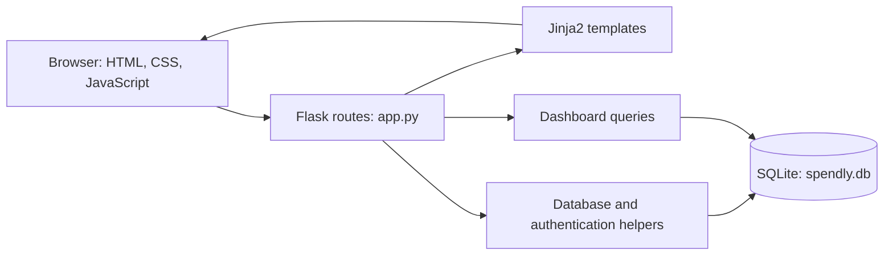

# Spendly
### An expense-tracking prototype built to learn spec-driven development with Claude

Spendly is a personal expense-tracking web application built with **Python, Flask, SQLite, and Jinja2**. I used this project to practice turning written requirements into implementation plans, building features with Claude, and reviewing the result against the specification.

**Status:** Learning prototype in progress. Authentication and a database-backed dashboard are implemented; adding, editing, and deleting expenses through the UI are planned.

[Explore the specifications](.claude/specs/) · [Implementation plans](.claude/plans/) · [Development workflow](instructions.md)

## Project preview


*Repository screenshot captured during development; the current interface may differ.*

## Why I built this

The main objective was to learn **spec-driven development using Claude**, with Spendly providing a practical application to build incrementally.

The workflow documented in this repository is:

1. Define the feature scope, requirements, and acceptance criteria.
2. Review and save the specification.
3. Ask Claude to produce an implementation plan from the specification and existing code.
4. Review the plan and implement the feature on a branch.
5. Review the changes and validate them against the specification.
6. Iterate, commit, and open a pull request.

The specifications and plans are part of the project deliverable: they show how requirements were broken into manageable implementation steps. Claude assisted development; this app does not contain an AI assistant or require a Claude API key to run.

## Current capabilities

| Capability | Current status |
|---|---|
| Landing, registration, and login pages | Implemented |
| Registration with server-side validation and password hashing | Implemented |
| Session-based login and logout | Implemented |
| Protected profile dashboard | Implemented |
| Total spending, transaction count, and top spending category | Implemented |
| Ten most recent transactions and category breakdown | Implemented |
| SQLite schema initialization and sample data | Implemented |
| Add, edit, and delete expenses through the UI | Planned; routes currently return placeholder messages |

These statuses describe the source implementation, not a claim of production readiness or a completed runtime verification.

## Specifications and implementation evidence

| Milestone | Specification | Plan | Implementation |
|---|---|---|---|
| Database setup | [Spec](.claude/specs/01-database-setup.md) | [Plan](.claude/plans/01-database-setup.md) | [Database helpers](database/db.py) |
| Registration | [Spec](.claude/specs/02-registration.md) | [Plan](.claude/plans/02-registration.md) | [Flask routes](app.py) |
| Login and logout | [Spec](.claude/specs/03-login-and-logout.md) | [Plan](.claude/plans/03-login-and-logout-plan.md) | [Flask routes](app.py) |
| Profile page | [Spec](.claude/specs/04-profile-page.md) | [Plan](.claude/plans/04-profile-page-plan.md) | [Profile template](templates/profile.html) |
| Profile database integration | Specification file currently empty | [Plan](.claude/plans/05-backend-connection-plan.md) | [Queries](database/queries.py) · [Tests](tests/test_backend_connection.py) |

The incomplete backend specification is a documentation gap to close. Any specification reconstructed after implementation should be identified as retrospective.

## Architecture



| Layer | Technology / responsibility |
|---|---|
| Backend | Flask routes, form processing, sessions, and redirects |
| Views | Jinja2 templates with shared layout |
| Frontend | HTML, custom CSS, and vanilla JavaScript |
| Persistence | SQLite with parameterized queries and foreign-key enforcement |
| Passwords | Werkzeug password hashing and verification |
| Testing | pytest and pytest-flask |
| Development assistance | Claude, specifications, implementation plans, and project guidance |

## Run locally

Use **Python 3.10+**. Run commands from the repository root so the relative SQLite path resolves consistently.

```bash
git clone https://github.com/subhashdixit/Spendly.git
cd Spendly
python3 -m venv .venv
source .venv/bin/activate
python -m pip install -r requirements.txt
python app.py
```

On Windows, create the environment with `python -m venv .venv` and activate it in PowerShell with `.\.venv\Scripts\Activate.ps1`.

Open **http://localhost:5001**.

The application initializes its database on startup. If the users table is empty, it seeds a development account and eight sample expenses. The repository also contains a database snapshot, so an existing checkout may already contain records.

### Explore the dashboard

Register a new account to see the empty dashboard. For a fresh database seeded by the application, the development login is:

- Email: `demo@spendly.com`
- Password: `demo123`

These are public development credentials, intended only for local sample data. The seed function does not recreate that account when other users already exist.

To generate additional sample data locally:

```bash
python seed_random_user.py
python seed_expenses.py <user_id> 50 6
```

The first command prints the generated user ID and email; that user's development password is `password123`. Replace `<user_id>` in the second command with the printed ID to add 50 expenses over approximately six months. Use positive counts and nonnegative month values. These scripts write to the local database.

## Tests and validation

Run the self-contained test directory with:

```bash
python -m pytest tests/ -v
```

The existing suite covers dashboard queries, empty states, category-percentage calculations, and authenticated/unauthenticated profile access. Passing results and coverage percentages are not claimed here.

The separate root-level `test_profile.py` is a live-server smoke script. It requires a running app and the `requests` package, which is not in `requirements.txt`; it also creates a test user. Use a disposable local database if running it. A bare `pytest` command also discovers this script, so use `pytest tests/` for the self-contained suite.

## Repository guide

```text
Spendly/
├── app.py                  # Application entry point and routes
├── database/
│   ├── db.py               # Connections, schema, seeding, authentication
│   └── queries.py          # Dashboard data queries
├── templates/              # Jinja2 pages and shared layout
├── static/                 # CSS and JavaScript
├── tests/                  # Database and profile integration tests
├── .claude/
│   ├── specs/              # Feature requirements
│   ├── plans/              # Implementation plans
│   ├── commands/           # Reusable development commands
│   └── CLAUDE.md           # Guidance for Claude
├── instructions.md         # Spec-to-PR workflow
├── seed_expenses.py         # Sample expense generator
├── seed_random_user.py      # Sample user generator
└── requirements.txt        # Pinned dependencies
```

## Learning focus

- Writing explicit requirements and acceptance criteria before implementation.
- Using repository context and constraints to guide Claude.
- Separating specifications, implementation plans, and application code.
- Reviewing AI-assisted changes and validating database-backed features.
- Keeping documentation aligned with implemented behavior.

This repository records an ongoing learning exercise. It does not claim measured productivity gains or production usage.

## Limitations and next steps

- Implement expense creation, editing, and deletion with ownership checks and validation.
- Complete the backend integration specification and keep feature status current.
- Expand authentication and expense-management tests, and add automated CI checks.
- Before public deployment, replace the hardcoded development session key, disable debug mode, review form protection and session settings, and use a controlled demo database.
- Review the tracked database snapshot and adopt a reproducible synthetic-data-only demo.
- Add an updated dashboard screenshot, a short walkthrough, and a hosted demo when ready.

## Author and license

**Subhash Dixit** · [GitHub](https://github.com/subhashdixit) · [LinkedIn](https://www.linkedin.com/in/subhash-dixit-nit-durgapur/)

Licensed under [Apache License 2.0](LICENSE).
